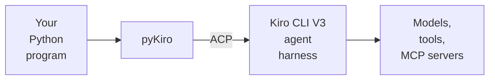

<div align="center">

# pyKiro

**Kiro's agent harness, inside your Python code.**

[](pyproject.toml)
[](LICENSE)
[](CHANGELOG.md)

</div>

pyKiro lets your Python programs use [Kiro](https://kiro.dev) as an AI agent, with the Kiro subscription you already
have. One import, one call, and Kiro answers:

```python
from pykiro import ask_sync

answer = ask_sync("Explain recursion to a five-year-old, in two sentences.", model="claude-haiku-5.5")
print(answer.text)
```

## What is this?

You probably know Kiro already: you chat with it in your editor or terminal, and it reads code, runs commands and
edits files for you. But a person always sits there and types.

**pyKiro lets your code do the typing.** It starts Kiro CLI in the background, talks to it, and gives you plain
Python objects back: a conversation, the agent's reply, the credits it spent. Your scripts, pipelines and apps get
the same agent harness that runs Kiro IDE and Kiro CLI, signed in with your own Kiro account. There are no API keys
in your code.



At the center of Kiro is its [unified agent harness](https://kiro.dev/docs/how-kiro-works/): the engine that runs
the agent loop, calls tools, manages context, checks permissions and talks to the models. Kiro IDE, CLI and Web are
all front ends to that one harness, and they reach it over the
[Agent Client Protocol](https://agentclientprotocol.com) (ACP), an open standard for talking to coding agents. Kiro
CLI's [V3 engine](https://kiro.dev/docs/cli/v3/) serves the same harness to any ACP client through
`kiro-cli acp --agent-engine=v3` ([Kiro's ACP docs](https://kiro.dev/docs/acp/)). pyKiro is one more front end, made
for code instead of people. You don't need to know anything about ACP to use it.

It's for Kiro users who want to automate their own work, teams who want Kiro in their pipelines, and developers who
want an agent inside their own tools. It runs on your machine with your own login (or Kiro's headless mode in CI).

## Why pyKiro?

- 🔑 **Your login, no API keys.** pyKiro uses the login Kiro CLI already has. Nothing secret goes into your code.
- 🧰 **The whole harness, not just a model.** The agent loop, Kiro's models, its built-in tools (files, shell, web),
  MCP servers, steering, skills and permission rules all come along.
- 🔗 **One harness for people and programs.** It's the same harness as Kiro IDE and CLI, so your team's `.kiro`
  setup in the repo works from code too.
- 🐍 **Your functions become agent tools.** Write a typed Python function, and the agent can call it. No server and
  no schema to write.
- 📦 **Data, not just text.** Describe the answer with a Pydantic model and get a validated Python object back.
- 🔁 **Repeatable runs.** Prompts, model and agent settings live in your code, so the setup repeats every time (the
  model's wording still varies).
- 🛡️ **Isolated, with you in control.** By default, every run starts from its own clean Kiro setup, so your
  `~/.kiro` stays out of it. You pick the folder the agent works in and what it may do, and anything it asks permission for is refused
  unless you allow it. It's not a sandbox, though: the agent still acts as you, on your machine.
- ⚙️ **Made for automation.** Run many conversations in parallel, work through batches, and plug Kiro into CI/CD.
- 💸 **Costs you can see.** Every turn tells you how many credits it spent.

## See it in action

pyKiro is async by design (it's built on `asyncio`). `ask_sync()` is the shortcut for one quick question. For
anything more, keep Kiro running and talk to it:

```python
import asyncio
import tempfile

from pykiro import KiroClient


async def main():
    # An empty folder for the agent to work in
    with tempfile.TemporaryDirectory() as workspace:
        # 1. Start Kiro (one kiro-cli process in the background)
        async with KiroClient(cwd=workspace) as client:
            # 2. Open a session (one conversation)
            session = await client.new_session(model="claude-haiku-5.5")

            async with session:
                # 3. Send messages: Kiro remembers the earlier ones
                result = await session.send("Suggest three short names for a houseplant tracker app.")
                print(result.text)

                result = await session.send("Pick your favourite and give it a one-line tagline.")
                print(result.text)

            # 4. See what the conversation cost
            print(f"Credits spent: {session.credits:.4f}")


asyncio.run(main())
```

```text
1. Leafly
2. Fernly
3. Sprout Log
Fernly, with the tagline: "Keep every houseplant alive, one watering at a time."
Credits spent: 0.0253
```

- A `KiroClient` is one running Kiro process. Starting Kiro takes a few seconds, so start it once and reuse it.
- A session is one conversation. Kiro remembers what was said, so you send only the new message.
- `async with` closes the session and stops Kiro at the end of the block, even after an error.
- The agent works in the folder you give it (`cwd`). An empty temporary folder keeps your own files out of reach.

## Getting started

**1. What you need:** Python 3.11–3.14 and a Kiro account. pyKiro is tested on Linux with each supported Python version.

**2. Install Kiro CLI and log in.** pyKiro needs a Kiro CLI with the [V3 engine](https://kiro.dev/docs/cli/v3/).
Follow [Kiro's installation guide](https://kiro.dev/docs/getting-started/installation), then:

```bash
kiro-cli --version     # tested with 2.37.0
kiro-cli login         # opens your browser; use --use-device-flow on a machine without one
```

In CI, where nobody can log in, set `KIRO_API_KEY` instead ([headless mode](https://kiro.dev/docs/cli/headless/)).
A `KIRO_API_KEY` in the environment takes priority over the login.

**3. Install pyKiro** straight from GitHub:

```bash
pip install git+https://github.com/galuszkm/pyKiro
```

In a uv project, use `uv add git+https://github.com/galuszkm/pyKiro` instead.

**4. Ask your first question.** Save the example at the top of this page as `hello.py` and run it:

```bash
python hello.py         # or, in a uv project: uv run python hello.py
```

Every turn spends credits from your Kiro plan. The examples here use the small `claude-haiku-5.5` model and cost a
few hundredths of a credit each. If that model isn't on your account, pick another one
([Models and Credits](docs/05_Models_and_Credits.md)). Something not working? The
[Quick Start](docs/02_Quick_Start.md) chapter lists the first errors you might see and how to fix them.

## Documentation

[`docs/`](docs/README.md) has 15 short chapters. Each one covers one topic and is built around a complete program
you can copy and run.

| # | Chapter | You'll build |
|---|---|---|
| 01 | [Introduction](docs/01_Introduction.md) | The big picture: what Kiro, ACP and pyKiro are |
| 02 | [Quick Start](docs/02_Quick_Start.md) | Your first question, and what to do when it fails |
| 03 | [Conversations](docs/03_Conversations.md) | A three-turn chat on one Kiro process |
| 04 | [Streaming Events](docs/04_Streaming_Events.md) | Your own live console for a turn, with a deadline |
| 05 | [Models and Credits](docs/05_Models_and_Credits.md) | A free price list and one priced question |
| 06 | [Structured Output](docs/06_Structured_Output.md) | Meeting notes turned into validated action items |
| 07 | [Images and Documents](docs/07_Images_and_Documents.md) | A chart-versus-report checker |
| 08 | [App Tools](docs/08_App_Tools.md) | A to-do list the agent manages through your functions |
| 09 | [Custom Agents](docs/09_Custom_Agents.md) | A read-only code guide |
| 10 | [Permissions](docs/10_Permissions.md) | A docs writer that may write only into `out/` |
| 11 | [Project Config and Profiles](docs/11_Project_Config_and_Profiles.md) | Reuse a project's `.kiro` steering and skill |
| 12 | [MCP Servers](docs/12_MCP_Servers.md) | Plug in `mcp-server-time` |
| 13 | [Saving and Resuming Sessions](docs/13_Saving_and_Resuming_Sessions.md) | A journal that remembers across runs |
| 14 | [Batch Jobs](docs/14_Batch_Jobs.md) | Feedback triage over a CSV, in parallel |
| 15 | [CI/CD](docs/15_CI_CD.md) | An AI review step in GitHub Actions |

## Developer setup

Want to work on pyKiro itself? You need Python 3.11–3.14, uv and git. Kiro CLI is needed only for the live tests.

```bash
git clone https://github.com/galuszkm/pyKiro.git
cd pyKiro
uv run just install      # every dependency group, plus the git hooks (once after cloning)

uv run just check        # format, lint, type-check, security scan
uv run just test         # unit and integration tests with coverage: no Kiro, no credits
uv run just test-live    # live tests against your real kiro-cli login (spends a few credits)
```

`uv run just` lists every task. See [CONTRIBUTING.md](CONTRIBUTING.md) for the workflow,
[AGENTS.md](AGENTS.md) for the coding standards, [RELEASING.md](RELEASING.md) for releases and
[CHANGELOG.md](CHANGELOG.md) for the history. Found a security problem? Please follow [SECURITY.md](SECURITY.md).

## License

Apache 2.0. See [LICENSE](LICENSE).
