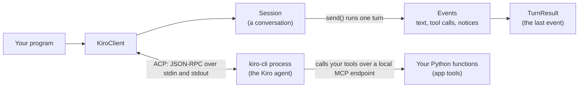

# 01 · Introduction

You probably use Kiro already, in your editor or in your terminal. Now imagine your Python scripts could use the same
agent: no clicking, no copy-pasting, just code. That's pyKiro. This chapter is the "what and why" before any real
code.

## What you'll learn

- What Kiro, Kiro CLI and pyKiro are, and how they fit together.
- What pyKiro is good for, and what it's not.
- The mental model you'll use in every other chapter.

## Kiro, Kiro CLI and ACP

[Kiro](https://kiro.dev/docs/) is an AI development environment. At its heart is an **agent**: an AI model plus
tools (read and write files, run commands, fetch web pages), permission rules, MCP servers, steering files and
skills. You log in once with your Kiro account, and every request spends a bit of the credits in your plan.

**Kiro CLI** is Kiro in your terminal. Its command `kiro-cli acp` starts Kiro as an **ACP agent**.
[ACP](https://agentclientprotocol.com), the Agent Client Protocol, is an open standard for how a program talks to a
coding agent. If you know LSP (the protocol that lets any editor work with any language server), ACP is the same
idea for AI agents. pyKiro needs Kiro CLI's newer agent engine, **V3** ([what's new in V3](https://kiro.dev/docs/cli/v3/)).

## Meet pyKiro

**pyKiro** is a small Python library. It starts `kiro-cli` for you, speaks ACP with it, and gives you plain Python
objects to work with: clients, sessions, turns, events, tools and typed results. Here's the whole idea in code:

```python
from pykiro import ask_sync

answer = ask_sync("Summarise Hamlet in one sentence.", model="claude-haiku-5.5")
print(answer.text)
```

That one call starts Kiro, asks the question and shuts Kiro down again. It cost us about 0.01 credits.

What's different from calling a model API directly? There's no API key in your code and no model SDK to learn. You
use **your own Kiro login**, so you get the *whole* Kiro agent, not just a model.

| Who | What they do |
|---|---|
| **Kiro** | The agent: models, built-in tools, permission rules, stored sessions, MCP servers. |
| **pyKiro** | The `kiro-cli` process, the configuration Kiro loads, and the conversation. |
| **You** | Your program: what to ask, which tools to offer, what to allow. |

## What it's for

- **Repeatable setups.** Prompts in code, a pinned model, a clean Kiro configuration and typed results. The *setup*
  repeats. The model's words still vary from run to run.
- **Automation.** Chain turns, sessions and your own functions into a job that runs by itself.
- **Pipelines and CI/CD.** Batches, exit codes, and Kiro's headless mode that logs in with an API key.
- **Your code as tools.** A typed Python function *is* an agent tool. No server code on your side.
- **One agent for people and programs.** Your team's `.kiro` setup in the repo works from code too.

It's for Kiro users who want to automate their own work, teams wiring Kiro into pipelines, and developers who put an
agent into their own tools.

## What pyKiro is not

- **Not a model SDK.** It drives Kiro, and Kiro calls the model.
- **Not an agent framework.** No graphs, no retry engines, no memory stores. Plain Python, plus Kiro's sessions.
- **Not a sandbox.** The agent acts on your machine, as you. Permissions lower the risk, they don't remove it.
- **Not a way to share your login.** It's for programs on your own machine with your own login (or Kiro's headless
  mode in CI). Read Kiro's terms before you build something that serves other people.

## The mental model

Here's the picture to keep in your head. Your program talks to a `KiroClient`, which is one running `kiro-cli`
process. On the client you open sessions, which are conversations. In a session you run turns. A **turn** is one
message from you plus everything the agent does until it's done, and it gives you a stream of events and, at the end,
a result.



And the three levels of the API, from smallest to biggest:

| Object | What it is | Cost to create one |
|---|---|---|
| `ask()` / `ask_sync()` | One question, one answer. Starts Kiro, runs one turn, stops Kiro. | A Kiro start, a few seconds. |
| `KiroClient` | One running Kiro process. You start it, use it, and close it. | A Kiro start, a few seconds. |
| `Session` | One conversation on a client. Kiro remembers its earlier turns. | A second or two. |

**pyKiro is natively async.** It's built on [asyncio](https://docs.python.org/3/library/asyncio.html) by design:
every call that talks to Kiro is awaited, so one program can stream text, run your tools, answer permission
questions and drive many sessions at once.

- In a script: put your code in `async def main()` and run it with `asyncio.run(main())`.
- For one quick question: `ask_sync()` does the `asyncio.run` for you.

## Where to next

Next: [02 · Quick Start](02_Quick_Start.md), where you install everything and ask your first question. Back to
[all chapters](README.md).
