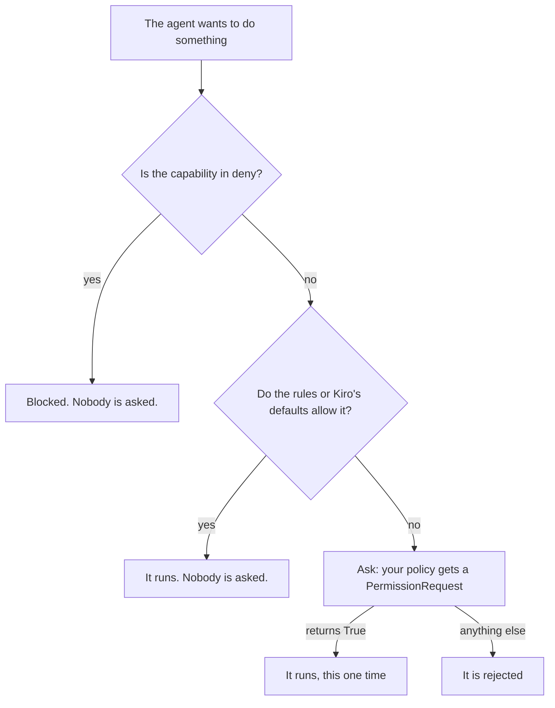

# 10 · Permissions

The agent runs on your machine, and it can do real things: read files, write files, run commands, fetch web pages.
In this chapter we decide exactly what it may do. We build a docs writer that may read its workspace and write only
into `out/`, and we watch it get refused when it tries to write anywhere else.

## What you'll learn

- The three outcomes of every action: **allow**, **deny** and **ask**. Only *ask* reaches your code.
- How to write a **policy**: a plain function that answers `True` or not.
- How to check paths properly, and why `deny=` is a hard wall.

## The big idea

Before each action, Kiro checks its permission rules. Every check ends in one of three outcomes:



Your **policy** (the type is `PermissionPolicy`: a plain function or an `async def`) gets a `PermissionRequest` and
answers `True` (allow this one time) or anything else (reject). Pass it to `ask_sync(..., policy=...)`,
`new_session(policy=...)` or `KiroClient(policy=...)`. No policy means every ask is rejected. These are the fields
that matter:

| Field | What it holds | Example |
|---|---|---|
| `capability` | The kind of action, from Kiro. | `fs_read`, `fs_write`, `shell`, `web_fetch` |
| `resource` | What it acts on: a file path, a command line, a host. | `out/guide.md` |
| `raw_input` | The arguments of the tool call. | `{"path": "..."}` |
| `title` | A description **written by the model**. Show it to a person, never decide on it. | |

The request also lists the answers Kiro offers, in `options` (`PermissionOption`s like "allow once" or "reject
always"). You don't pick one: pyKiro turns your `True` into "allow once" and anything else into "reject once".

## The full code

```python
"""A docs writer that may read its workspace and write only into out/."""

import tempfile
from pathlib import Path

from pykiro import AnsiRenderer, PermissionRequest, ask_sync

MODEL = "claude-haiku-5.5"
PROMPT = (
    "Read facts.txt and write a short friendly guide from it to out/guide.md. "
    "Then save a copy of the same guide to ../notes.md. If a file can't be written, just say so."
)


def inside(workspace: Path, folder: Path, resource: str | None) -> bool:
    """Whether Kiro's resource (relative to the workspace, or absolute) is inside folder."""
    if not resource:
        return False
    path = (workspace / resource).resolve()
    return path.is_relative_to(folder.resolve())


def make_policy(workspace: Path):
    """Build a policy: read anywhere in the workspace, write only into out/, refuse everything else."""

    def policy(request: PermissionRequest) -> bool:
        if request.capability == "fs_read":
            allowed = inside(workspace, workspace, request.resource)
        elif request.capability == "fs_write":
            allowed = inside(workspace, workspace / "out", request.resource)
        else:
            allowed = False

        if allowed:
            print(f"[allowed: {request.capability} {request.resource}]")
        else:
            print(f"[refused: {request.capability} {request.resource}]")
        return allowed

    return policy


# A folder with a "workspace" inside it, so a file one level up is still ours to throw away
with tempfile.TemporaryDirectory() as folder:
    root = Path(folder)
    workspace = root / "workspace"
    workspace.mkdir()
    (workspace / "facts.txt").write_text("Our shop opens at 9. Parcels ship on Tuesdays. Returns take 14 days.\n")

    # 1. Ask Kiro, with our policy and the shell switched off
    ask_sync(
        PROMPT,
        cwd=workspace,
        model=MODEL,
        deny=["shell"],
        policy=make_policy(workspace),
        on_event=AnsiRenderer(),
    )

    # 2. Show the files on disk
    print("\nFiles on disk:")
    for path in sorted(root.rglob("*")):
        if path.is_file():
            print(f"  {path.relative_to(root)}")
```

Save it as `docs_writer.py` and run `python docs_writer.py`. One run costs about 0.02 credits.

### What you'll see

```text
⚙ Read File  {"path": "/work/workspace/facts.txt", "offset": null, "limit": null}
[allowed: fs_read facts.txt]
✓ Read File
⚙ Write File  {"path": "/work/workspace/out/guide.md", "text": "# Welcome to Our S…
⚙ Write File  {"path": "/work/notes.md", "text": "# Welcome to Our Shop: A Quick G…
[refused: fs_write /work/notes.md]
✗ Write File
[allowed: fs_write out/guide.md]
✓ Write File
kiro › I wrote the guide to `out/guide.md` in the workspace. The copy to `../notes.md` was rejected when I tried to write it, so I did not create that file. I did not retry.
── end_turn · 0.0222 credits · 8.9 s ──

Files on disk:
  workspace/facts.txt
  workspace/out/guide.md
```

This is a real run, trimmed: we cut the "thinking" lines and replaced the temp folder's name with `/work`. The file
list is the proof: `out/guide.md` exists, `notes.md` doesn't. The agent's polite report is a bonus, not a guarantee.

## How it works

### The policy: no, unless

```python
if request.capability == "fs_read":
    allowed = inside(workspace, workspace, request.resource)
elif request.capability == "fs_write":
    allowed = inside(workspace, workspace / "out", request.resource)
else:
    allowed = False
```

A read is fine inside the workspace. A write is fine only inside `out/`. **Anything else is refused**, and that's the
important line: web fetches, MCP tools, and capabilities that don't even exist yet. A policy that says "no" by
default is a policy you can trust. "Yes, unless it's on my blocklist" forgets something sooner or later.

`make_policy` is a **factory**: a function that builds and returns the policy, so the policy remembers which folder
it protects. pyKiro calls a plain policy on a worker thread, and two asks can overlap, so keep it quick and simple.

### Is this path really inside?

```python
path = (workspace / resource).resolve()
return path.is_relative_to(folder.resolve())
```

Observed on kiro-cli 2.34.0: for a file inside the workspace, `resource` is **relative** (`out/guide.md`), and for a
file outside it's **absolute**. `workspace / resource` handles both: an absolute path simply replaces the workspace.
Then `.resolve()` removes `..` and follows symlinks, and `is_relative_to` asks the real question. Why not
`resource.startswith("out/")`? Because `out/../../secrets.txt` starts with `out/` too. Compare resolved paths, never
strings. And no `resource` at all means no.

The temp folder has a `workspace` folder *inside* it, so the agent's attempt at `../notes.md` lands in our throwaway
folder, not in the middle of `/tmp`.

### Deny: a hard wall

```python
ask_sync(
    PROMPT,
    cwd=workspace,
    model=MODEL,
    deny=["shell"],
    policy=make_policy(workspace),
    on_event=AnsiRenderer(),
)
```

`deny=` is checked *before* any policy, and no policy can open it. Why deny `shell` when our policy would refuse it
anyway? Because a hard limit beats a hopeful one, and a shell can write files too (`echo hi > file`). Think in
**capabilities**, not in tools. Setting `deny` also makes this a custom agent ([chapter 09](09_Custom_Agents.md)),
and those sessions ask even for reads. That's why our policy needs a read rule.

### Allow rules: quick, but wide

If an action is always fine, a rule is shorter than a policy: `allow=["fs_write"]` moves writes from *ask* to *allow*.
The catch, observed on kiro-cli 2.34.0: that rule also lets writes **outside the workspace** through, with no ask.
`allow=["shell"]` covers every command. If you care *where* files go, or *which* command runs, use a policy.

### Ask a person

A policy is just a function, so it can ask *you*. This is a variation, not part of the program above:

```python
def ask_person(request: PermissionRequest) -> bool:
    """Show the ask and wait for y/N."""
    print(f"\nKiro wants to use {request.capability}: {request.resource}")
    try:
        answer = input("  Allow? [y/N] ")
    except EOFError:  # nobody is there to answer
        return False
    return answer.strip().lower() == "y"
```

The agent simply waits while you think. Two asks can overlap, so in a bigger program put a `threading.Lock` around
the question, or two prompts fight over one keyboard. Show `capability`, `resource` and `raw_input`, not the `title`.

### Safety checklist

- **Start from an empty folder.** Put in only what the job needs. The agent can read everything in `cwd`.
- **Take away what you don't need.** `kiro_tools=[...]` removes tools, `deny=[...]` closes capabilities. Deny `shell`
  whenever you deny `fs_write`.
- **Treat every input as untrusted.** Text in a file, a web page or a CSV row can contain orders for the agent
  (**prompt injection**). The cure is walls, not nicer wording in your prompt.
- **Allowed commands run code as you.** pyKiro is not a sandbox. Match a command exactly, never by its beginning:
  `python3 -m unittest` as a prefix also matches `python3 -m unittest; rm -rf ~`. For code you don't trust, use a
  container or a VM.
- **Your environment travels.** Kiro gets your full environment, so a command it runs can see your API keys and
  tokens. One more reason for "no shell".
- **Answers are untrusted text.** Validate them with `result_type`, and never `eval` them or paste them into a shell.

## Gotchas, side effects and risks

- **Only `True` allows.** `return 1` rejects. A policy that raises is logged and rejects.
- **Allow once, never always.** pyKiro answers each ask on its own. To remember a "yes", do it in your own code.
- **A slow policy stalls the turn.** The agent waits as long as your policy takes. A cancel (a deadline, `break`)
  answers the ask `cancelled` at once, but an `input()` still waits for its key.
- **Typos protect nothing.** Observed on kiro-cli 2.34.0: `deny=["shel"]` denies nothing. Run your setup once and look.
- **Your own app tools never reach the policy.** pyKiro approves them itself ([chapter 08](08_App_Tools.md)).

## Where to next

Previous: [09 · Custom Agents](09_Custom_Agents.md). Next:
[11 · Project Config and Profiles](11_Project_Config_and_Profiles.md), where the agent picks up a project's own
`.kiro` folder. Back to [all chapters](README.md).
